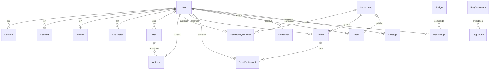

*This project has been created as part of the 42 curriculum by gcesar-n, dteruya, jcosta-b, ekeller-, rzamolo-.*

# Trilhas SP

## Description

**Trilhas SP** é uma plataforma de trilhas para São Paulo e arredores, inspirada no Wikiloc. O objetivo é reunir num só lugar o catálogo de trilhas da região, o registro do que cada pessoa percorreu e a conversa entre quem faz trilha.

**Funcionalidades principais:**
- Catálogo de trilhas do OpenStreetMap, com mapa e página de detalhe.
- Registro de atividades, XP, emblemas e ranking.
- Conta com e-mail e senha, OAuth, 2FA, perfil e avatar.
- Privacidade (GDPR): baixar os próprios dados e excluir a conta.
- Amigos, chat e notificações em tempo real.
- Assistente de IA sobre as trilhas (RAG e LLM).
- PWA instalável, com suporte offline.

## Instructions

**Pré-requisitos:**
- Docker com o plugin Compose v2 (`docker compose`); testado com Docker 29.7 e Compose 5.4.
- GNU Make 4 e OpenSSL 3.0 ou mais novo.
- Google Chrome, versão estável mais recente.

**Configuração:** nenhuma é obrigatória. Na primeira execução, o `make` cria `docker/.env` a partir de [`docker/.env.example`](docker/.env.example) (usuário e nome do banco, portas), gera as senhas em `docker/secrets/` e o certificado HTTPS em `docker/nginx/certs/`. Nada disso vai para o git. Opcional: para ligar o assistente de IA, cole uma chave do Google Gemini em `docker/secrets/gemini_api_key.txt` antes do `make` (sem ela, o resto do app funciona).

**Execução:**
1. `make`
2. No Chrome, importe `docker/nginx/certs/ca.crt` em `chrome://certificate-manager` como autoridade confiável e reinicie o Chrome (`chrome://restart`).
3. Acesse **https://localhost:8443**.

Para parar: `make down`. Para apagar tudo, inclusive o banco: `make fclean`.

## Resources

- [Next.js](https://nextjs.org/docs), [Prisma](https://www.prisma.io/docs), [Better Auth](https://www.better-auth.com/docs), [Socket.IO](https://socket.io/docs/v4/), [Zod](https://zod.dev), [Tailwind CSS](https://tailwindcss.com/docs), [nginx](https://nginx.org/en/docs/), [Docker Compose](https://docs.docker.com/compose/), [pgvector](https://github.com/pgvector/pgvector), [Vercel AI SDK](https://ai-sdk.dev/docs), [Gemini API](https://ai.google.dev/gemini-api/docs)
- [OpenStreetMap: Map features](https://wiki.openstreetmap.org/wiki/Map_features), [API da intra 42](https://api.intra.42.fr/apidoc)
- [PostgreSQL: isolamento de transações](https://www.postgresql.org/docs/current/transaction-iso.html), [TOTP (RFC 6238)](https://datatracker.ietf.org/doc/html/rfc6238), [OAuth com PKCE (RFC 7636)](https://datatracker.ietf.org/doc/html/rfc7636)

**Uso de IA:** *(a completar)*
- No corpus do assistente: as descrições das 88 trilhas foram geradas pelo Google Gemini só com os dados do OpenStreetMap (distância, desnível, piso, região), e os guias gerais foram rascunhados com IA, para revisão do time.

## Team Information

| Membro | Login | Papel | Responsabilidades |
|---|---|---|---|
| Juh | `jcosta-b` | Product Owner + Dev | Frontend, design system, PWA |
| Gabriel | `gcesar-n` | Project Manager + Dev | Backend, banco, Docker, nginx e HTTPS |
| Diego | `dteruya` | Project Manager + Dev | Autenticação, perfil, OAuth, 2FA, GDPR |
| Rafael | `rzamolo-` | Tech Lead + Dev | Amigos, chat, tempo real, notificações |
| Eduardo | `ekeller-` | Tech Lead + Dev | IA (LLM, RAG) e gamificação |

## Project Management

- **Organização:** cada pessoa é dona de uma área e dos módulos dela; o status de cada módulo fica em [docs/MODULOS.md](docs/MODULOS.md). Cada tarefa vira uma branch e uma pull request revisada por outra pessoa.
- **Ferramentas:** GitHub (código e pull requests) e documentação versionada em [`docs/`](docs/README.md).
- **Comunicação:** WhatsApp no dia a dia e Google Meet para reuniões.

## Technical Stack

| Camada | Tecnologia | Por quê |
|---|---|---|
| Frontend | Next.js 16 (React 19), Tailwind CSS 4 | Um framework para front e back; Tailwind como solução de estilo |
| Backend | Next.js (Route Handlers e Server Actions) | Um app só, sem microsserviços: menos peças para configurar e explicar |
| Banco | PostgreSQL 18 (PostGIS, pgvector) via Prisma 7 | Relacional, com schema legível; o pgvector serve o RAG sem outro banco |
| Autenticação | Better Auth | Hash com salt pronto; sessão no banco; plugins de OAuth e 2FA |
| Tempo real | Socket.IO | Salas por usuário e reconexão, no mesmo processo do Next |
| Validação | Zod | O mesmo schema valida o formulário e o servidor |
| IA | Vercel AI SDK 7 + Google Gemini | Camada gratuita; geração e embeddings na mesma API; streaming até o navegador e modelo falso para testes prontos no SDK |
| Infra | Docker Compose, nginx | Um comando sobe tudo; HTTPS com um só ponto de entrada |

## Database Schema

| Tabela | Campos principais (tipo) |
|---|---|
| `User` | `id` (String), `name` (String), `email` (String, único), `username` (String, único), `bio` (String?), `twoFactorEnabled` (Boolean) |
| `Session` | `token` (String, único), `expiresAt` (DateTime), `ipAddress` (String?), `userId` (FK) |
| `Account` | `providerId` (String: `credential`, `github`, `42`), `password` (String?, hash), `userId` (FK) |
| `Verification` | `identifier` (String), `value` (String), `expiresAt` (DateTime) |
| `TwoFactor` | `secret` (String, cifrado), `backupCodes` (String, cifrado), `userId` (FK) |
| `Avatar` | `userId` (PK, FK), `mime` (String), `data` (Bytes) |
| `Trail` | `source` (enum `OSM`/`USER`), `title` (String), `distance` (Float, m), `elevationGain` (Float?, m), `difficulty` (enum), `visibility` (enum), `routeGeoJSON` (Json), `minLat`…`maxLon` (Float), `authorId` (FK?) |
| `Activity` | `title` (String), `distance` (Float, m), `duration` (Int, s), `startedAt` (DateTime), `userId` (FK), `trailId` (FK?) |
| `Notification` | `message` (String), `isRead` (Boolean), `userId` (FK) |
| `Badge` / `UserBadge` | `name` (String, único) / `earnedAt` (DateTime), par `userId`+`badgeId` único |
| `AiUsage` | Rate limit do assistente de IA: `userId` (FK) + `period` (String: o minuto ou o dia, em UTC) como chave, `count` (Int). Não guarda o que foi perguntado |
| `RagDocument` / `RagChunk` | Base do assistente: documento (`source`: Wikipedia, trilha ou guia; `title`, `url`, `license`, `trailExternalId`) / trecho (`content`, `embedding` vector(768)). Carregada de um arquivo versionado; não guarda nada do usuário |
| `Community`, `CommunityMember`, `Event`, `EventParticipant`, `Post` | Comunidades, eventos e posts (adiados); `role` (enum) do membro; pares únicos por usuário |

Excluir um usuário apaga os dados dele em cascata; apagar uma trilha mantém as atividades, com `trailId` nulo.

## Features List

| Funcionalidade | Descrição | Responsável |
|---|---|---|
| Catálogo de trilhas | 3.878 trilhas do OpenStreetMap, importadas na subida do container | Gabriel |
| Busca de trilhas | Filtros, área do mapa, ordenação e paginação (`GET /api/trails`) | Gabriel |
| Trilhas e atividades | Criar, editar e excluir; distância, desnível e tempo calculados no servidor | Gabriel |
| HTTPS | nginx como único ponto de entrada | Gabriel |
| Cadastro e login | E-mail e senha, com rate limit | Diego |
| Perfil e avatar | Perfil editável, página pública, avatar com padrão | Diego |
| Segurança da conta | Troca de senha, sessões ativas, 2FA | Diego |
| OAuth | Login pelo GitHub e pela 42 | Diego |
| Privacidade e dados | Baixar os dados, excluir a conta com confirmação por e-mail, páginas de Privacidade e Termos | Diego, Gabriel |
| Tema e navegação | Cores, fontes e barra de navegação | Rafael |
| Pergunte sobre as trilhas (IA) | `/perguntar`: perguntas respondidas a partir de uma base própria (Wikipedia, trilhas do OSM, guias), com as fontes de cada resposta | Eduardo |
| Planejador de trilha com IA | `/planejar`: escolhe a trilha, a data, a experiência e as horas; o plano chega em streaming, com Parar, limite de uso e erro amigável | Eduardo |

## Modules

| Módulo | Tipo | Pts | Por que escolhemos | Como foi implementado | Responsável |
|---|---|---|---|---|---|
| Framework de frontend | Minor | 1 | Next.js já é a base do app | *A completar.* | Juh |
| Framework de backend | Minor | 1 | Front e back no mesmo framework | Route Handlers para leituras, Server Actions para formulários; erros e validação comuns em `src/server/api/` | Gabriel |
| ORM | Minor | 1 | Schema legível e acesso tipado ao banco | Prisma 7: schema com relações, migrations aplicadas na subida | Gabriel |
| Gerenciamento de usuários | Major | 2 | Toda funcionalidade depende de contas | Perfil, página pública, avatar validado pelo conteúdo | Diego |
| Interação entre usuários | Major | 2 | Fazer trilha é social | *A fazer.* | Rafael |
| Tempo real | Major | 2 | Chat e notificações ao vivo | Socket.IO autenticado, sala por usuário; eventos a fazer | Rafael, Gabriel |
| Interface de LLM | Major | 2 | Planejar uma trilha com ajuda | Planejador em `/planejar`: Gemini pelo Vercel AI SDK, streaming (SSE) com Parar, rate limit por usuário no banco, erro do provedor como mensagem amigável | Eduardo |
| Sistema RAG | Major | 2 | Perguntas sobre as trilhas, com fontes | `/perguntar`: embeddings do Gemini no pgvector, busca por distância de cosseno com limiar ("não encontrei"), resposta em streaming citando as fontes; índice versionado, carregado sem chamar a API | Eduardo |
| PWA | Minor | 1 | Usar o app na trilha, sem sinal | *A fazer.* | Juh |
| OAuth 2.0 | Minor | 1 | Entrar com a conta da 42 ou do GitHub | GitHub e 42 pelo Better Auth, com state e PKCE | Diego |
| Gamificação | Minor | 1 | Incentivar a registrar atividades | *A fazer.* | Eduardo |
| GDPR | Minor | 1 | O app guarda dados pessoais | Exportação em JSON; exclusão com senha e link por e-mail | Diego, Gabriel |
| Notificações | Minor | 1 | Avisar sobre cada ação | *A fazer.* | Rafael |
| 2FA | Minor | 1 | Proteger as contas | TOTP e códigos de recuperação | Diego |
| Design system | Minor | 1 | Identidade visual própria | *A fazer.* | Juh |
| **Total** | | **20** | | | |

## Individual Contributions

### Eduardo
*(a completar)*

### Juh
*(a completar)*

### Gabriel
*(a completar)*

### Diego
*(a completar)*

### Rafael
*(a completar)*

## Licença dos dados

Dados de mapa e trilhas © [OpenStreetMap contributors](https://www.openstreetmap.org/copyright), sob a licença ODbL. O catálogo derivado incluído neste repositório (`apps/web/prisma/data/`) também está sob ODbL.

Os artigos da Wikipedia usados pelo assistente (`apps/web/prisma/data/rag/wikipedia.json`) estão sob [CC BY-SA 4.0](https://creativecommons.org/licenses/by-sa/4.0/); cada resposta cita o título e o link do artigo.
