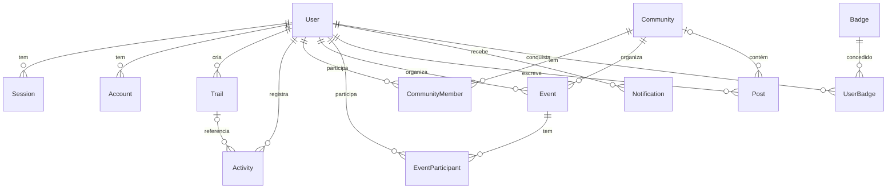

*This project has been created as part of the 42 curriculum by <login_eduardo>, <login_ju>, <login_gabriel>, <login_diego>, <login_rafael>.*

<!--
README EXIGIDO PELO SUBJECT (capítulo VI) E AVALIADO.
- A primeira linha acima é obrigatória, em itálico e com esse texto exato. Troque os <login_*> pelos logins da 42.
- Este arquivo é um RASCUNHO VIVO: cada seção diz quem atualiza e quando.
- Checklist das seções obrigatórias: docs/EVALUATION.md §3.
- Documentação interna do time: docs/README.md.
-->

# Trilhas SP *(nome provisório)*

## Description

**Trilhas SP** é uma plataforma de trilhas para São Paulo e cidades do entorno, inspirada no Wikiloc. O usuário descobre trilhas (um catálogo inicial do OpenStreetMap e trilhas publicadas por outros usuários), vê percurso, distância e desnível, publica as próprias trilhas, registra as atividades que fez, conversa com amigos em tempo real, participa de comunidades e de eventos (saídas em grupo), ganha emblemas e tira dúvidas com um assistente de IA que conhece as trilhas da região.

**Funcionalidades principais:**
- Catálogo de trilhas (OpenStreetMap + publicadas pelos usuários, públicas ou privadas) com mapa, busca avançada (filtros, ordenação e paginação) e página de detalhe.
- Registro de atividades, ranking por km e emblemas.
- Perfis, avatar, amigos com status online e chat 1:1 em tempo real.
- Comunidades com papéis, posts com mídia, comentários e eventos.
- Notificações em tempo real para as ações do usuário.
- Assistente de IA: perguntas sobre trilhas com fontes (RAG) e planejador de trilha com streaming (LLM).
- Arquitetura de microsserviços (`web` + `realtime` + `ai`) com monitoramento (Prometheus e Grafana), status page e backups automáticos.

<!-- Atualizado por: PO. Quando: ao fechar o M2 (revisar a lista). -->

## Instructions

<!-- Atualizado por: frente Plataforma. Fonte da verdade: Makefile e docker/. -->

### Pré-requisitos
- Docker com o plugin Docker Compose (`docker compose`) *(versões mínimas: a definir)*
- GNU Make e OpenSSL (o `make` gera os segredos com `openssl rand`)
- Navegador: Google Chrome (versão estável mais recente)

### Configuração
Nada é obrigatório na primeira vez: o `make` cria o que faltar.
- `docker/.env` é copiado de [`docker/.env.example`](docker/.env.example) (`POSTGRES_USER`, `POSTGRES_DB`, `BETTER_AUTH_URL`).
- `docker/secrets/db_password.txt` e `docker/secrets/better_auth_secret.txt` são gerados com valores aleatórios e entram nos containers como Docker secrets. **Não apague** esses arquivos com o banco já criado: a senha nova não abriria o banco existente.
- `data/postgres/` guarda os dados do Postgres (bind mount, fora do git).

### Execução
```bash
make            # build + sobe postgres e nextjs (equivale a `make up`)
```
Acesse **http://localhost:3000**. Ainda não há nginx nem HTTPS (previsto: [docs/frentes/plataforma](docs/frentes/plataforma/README.md)).

No start, o container `nextjs` monta a `DATABASE_URL` a partir do secret, roda `npm ci` se o `package-lock.json` mudou, `prisma generate`, `prisma migrate deploy` e então `next dev` com hot reload (o código de `apps/web` é montado no container).

| Comando | O que faz |
|---|---|
| `make` / `make up` | Gera `.env`, segredos e `data/postgres` se faltarem; `docker compose up -d --build` |
| `make build` | Só constrói as imagens |
| `make stop` / `make down` | Para os containers / remove os containers |
| `make logs` | Segue os logs (deve mostrar o `migrate deploy` e o "Ready" do Next) |
| `make sh` | Shell no container `nextjs` |
| `make npm args="install zod"` | Roda `npm` dentro do container |
| `make migrate name=<descricao>` | `prisma migrate dev --name <descricao>` dentro do container |
| `make studio` | Prisma Studio em http://localhost:5555 (profile `tools`) |
| `make clean` | Remove containers, imagens locais e volumes |
| `make fclean` | `clean` + apaga `data/postgres` (**apaga o banco**) |
| `make re` | `fclean` + `make` (sobe do zero) |

### Alterar o schema do banco
1. Edite [`apps/web/prisma/schema.prisma`](apps/web/prisma/schema.prisma).
2. `make migrate name=<descricao>` (com os containers de pé).
3. Faça commit do schema **junto** com a pasta `apps/web/prisma/migrations/`.

Quem baixar a mudança só precisa de `make up`: as migrations pendentes rodam no start.

Antes de commitar, `git status` não deve listar nada de `docker/secrets/`, `docker/.env` ou `data/postgres/`.

*(a completar: backup e restauração, quando existirem)*

## Resources

### Referências
- Next.js: https://nextjs.org/docs
- Prisma: https://www.prisma.io/docs
- Better Auth: https://www.better-auth.com/docs
- Socket.IO: https://socket.io/docs/v4/
- PostGIS: https://postgis.net/documentation/
- pgvector: https://github.com/pgvector/pgvector
- OpenStreetMap: https://wiki.openstreetmap.org/wiki/Map_features
- Prometheus: https://prometheus.io/docs/ · Grafana: https://grafana.com/docs/
- *(cada frente adiciona as referências que usou)*

### Uso de IA
<!--
OBRIGATÓRIO pelo subject: descrever como a IA foi usada, em quais tarefas e em quais partes do projeto.
Fonte: o campo "Uso de IA nesta PR" de cada PR. O PM consolida no M3.
-->
*(a completar no M3)*

## Team Information

<!-- Atualizado por: PM, no kickoff. -->

| Membro | Login | Papel(is) | Responsabilidades |
|---|---|---|---|
| Eduardo | `<login>` | *a definir* + Dev (frente *a definir*) | |
| Ju | `<login>` | *a definir* + Dev (frente *a definir*) | |
| Gabriel | `<login>` | *a definir* + Dev (frente *a definir*) | |
| Diego | `<login>` | *a definir* + Dev (frente *a definir*) | |
| Rafael | `<login>` | *a definir* + Dev (frente *a definir*) | |

## Project Management

<!-- Atualizado por: PM. Base: docs/PROCESS.md. -->

- **Organização:** 5 frentes de trabalho, cada uma com um dono; sprints semanais; planejamento às segundas, daily assíncrona, demo e "aula relâmpago" às sextas, retro quinzenal.
- **Ferramentas:** GitHub Issues + GitHub Projects (tarefas), documentação versionada em `docs/` (arquitetura, ADRs, contratos, status), PRs com revisão obrigatória.
- **Comunicação:** Discord (canais de daily, dev, PRs, bloqueios, decisões e alertas automáticos).

## Technical Stack

<!-- Atualizado por: Tech Lead. Justificativas detalhadas: docs/adr/. A coluna "Estado" diz o que já está no código. -->

| Camada | Tecnologia | Estado | Por quê |
|---|---|---|---|
| Frontend | Next.js 16 (React 19, App Router) | Em uso (`apps/web`) | Framework full-stack escolhido pelo time |
| Frontend | Tailwind CSS 4, shadcn/ui, Leaflet, Recharts | Tailwind instalado, ainda não configurado; o resto planejado | Componentes acessíveis; mapas simples de integrar ([ADR-0008](docs/adr/0008-frontend-mapas.md)) |
| Backend | Next.js (Route Handlers, Server Actions) | Em uso | [ADR-0001](docs/adr/0001-arquitetura-servicos.md) |
| Backend | Serviços Fastify (TypeScript): `realtime` e `ai` | Planejado | [ADR-0001](docs/adr/0001-arquitetura-servicos.md), [ADR-0002](docs/adr/0002-monorepo-typescript.md) |
| Banco | PostgreSQL 18 + PostGIS + pgvector, via Prisma 7 (`@prisma/adapter-pg`) | Em uso (um banco, um schema Prisma) | [ADR-0003](docs/adr/0003-banco-de-dados.md) |
| Tempo real | Socket.IO + Redis pub/sub | Planejado | [ADR-0005](docs/adr/0005-comunicacao.md) |
| Autenticação | Better Auth (e-mail e senha, adapter Prisma) | Configurado, ainda sem rotas | [ADR-0004](docs/adr/0004-autenticacao.md) |
| IA | *provedor a definir* + embeddings locais + pgvector | Planejado | [ADR-0007](docs/adr/0007-provedor-llm-embeddings.md) |
| Infra | Docker Compose (imagens Alpine próprias), Docker secrets, Makefile | Em uso | Comando único exigido pelo subject |
| Infra | nginx (TLS), Prometheus, Grafana, Alertmanager | Planejado | Módulos de DevOps |
| Qualidade | Biome (lint e formatação), TypeScript | Em uso | — |

## Database Schema

<!-- Atualizado por: Tech Lead. Fonte da verdade: apps/web/prisma/schema.prisma. Atualize o diagrama quando mudar uma relação. -->

O `web` usa o banco principal (`POSTGRES_DB`, padrão `trails`) com **um schema Prisma**: [`apps/web/prisma/schema.prisma`](apps/web/prisma/schema.prisma). Os serviços `realtime` e `ai` terão bancos próprios no mesmo servidor quando existirem ([ADR-0003](docs/adr/0003-banco-de-dados.md)).



| Grupo | Tabelas | Campos principais |
|---|---|---|
| Better Auth | `User`, `Session`, `Account`, `Verification` | Formato exigido pelo Better Auth (a senha fica em `Account.password`) |
| Trilhas | `Trail`, `Activity` | `Trail`: distância e desnível em metros, `difficulty` (`EASY`/`MODERATE`/`HARD`), `visibility` (`PUBLIC`/`PRIVATE`), percurso em `routeGeoJSON` (JSON) e bounding box (`minLat`…`maxLon`). `Activity`: distância, duração em segundos, `polyline`, trilha opcional |
| Social | `Community`, `CommunityMember`, `Event`, `EventParticipant`, `Post`, `Notification` | Papel do membro: `ADMIN`/`MODERATOR`/`MEMBER`; pares únicos (`userId`+`communityId`, `eventId`+`userId`) |
| Gamificação | `Badge`, `UserBadge` | Um emblema por usuário no máximo uma vez |

IDs do Better Auth são gerados pela biblioteca; os demais usam `cuid()`. Toda chave estrangeira apaga em cascata (exceto `Activity.trailId`, que vira nulo).

## Features List

<!--
Atualizado por: quem entregar a funcionalidade, no mesmo PR.
Formato: | Funcionalidade | Descrição | Responsável(is) |
-->

| Funcionalidade | Descrição | Responsável(is) |
|---|---|---|
| | | |

## Modules

<!-- Atualizado por: donos das frentes. Base: docs/MODULES.md. -->

| Módulo | Tipo | Pts | Justificativa e implementação | Responsável(is) |
|---|---|---|---|---|
| Framework frontend + backend (Next.js) | Major* | 2 | | |
| ORM (Prisma) | Minor | 1 | | |
| Gerenciamento padrão de usuários | Major | 2 | | |
| Interação entre usuários | Major | 2 | | |
| Recursos em tempo real (WebSockets) | Major | 2 | | |
| Backend em microsserviços | Major | 2 | | |
| Busca avançada | Minor | 1 | | |
| Upload e gestão de arquivos | Minor | 1 | | |
| Sistema de notificações | Minor | 1 | | |
| Interface de LLM | Major | 2 | | |
| Sistema RAG | Major | 2 | | |
| Monitoramento (Prometheus + Grafana) | Major | 2 | | |
| Health check, status page e backups | Minor | 1 | | |
| **Total** | | **21** | | |

\* Equivalente aos Minors "frontend framework" + "backend framework" (ver [docs/MODULES.md](docs/MODULES.md#1-pontuação)).

## Individual Contributions

<!--
ESCRITO POR CADA PESSOA, sobre si mesma (agentes de IA não preenchem esta seção).
Base: as seções "O que aprendi" das suas PRs + docs/LEARNING.md §5 (lições aprendidas).
-->

### Eduardo
*(a completar)*

### Ju
*(a completar)*

### Gabriel
*(a completar)*

### Diego
*(a completar)*

### Rafael
*(a completar)*

## Licenças e créditos

- Dados de mapa e trilhas © [OpenStreetMap contributors](https://www.openstreetmap.org/copyright), sob a licença ODbL. O catálogo derivado incluído neste repositório também está sob ODbL.
- Dados de elevação: Copernicus DEM GLO-90, via [Open-Meteo](https://open-meteo.com/).
- Trechos da Wikipedia usados no assistente: CC BY-SA, com a fonte citada em cada resposta.
