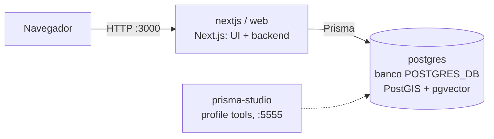
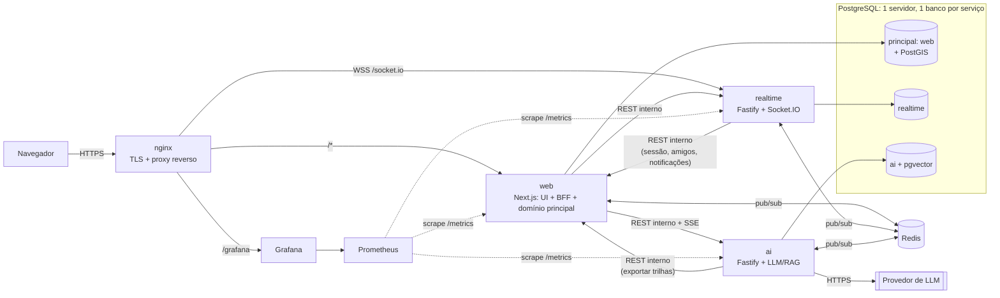
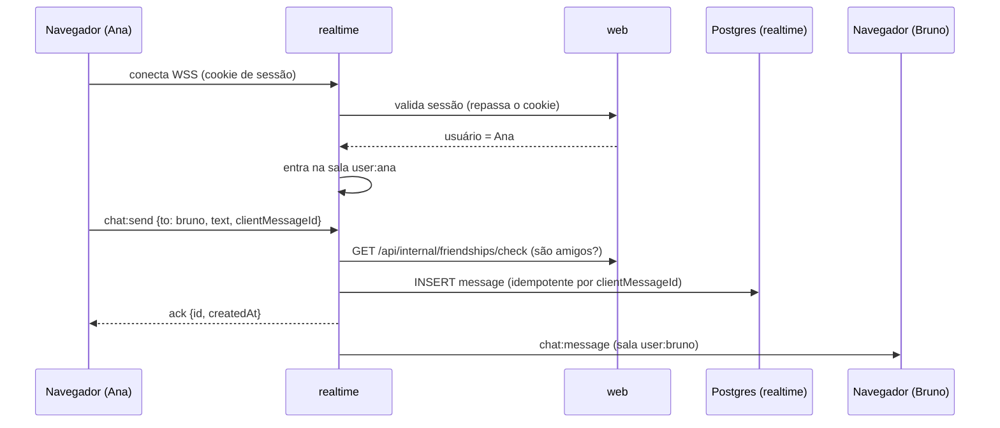
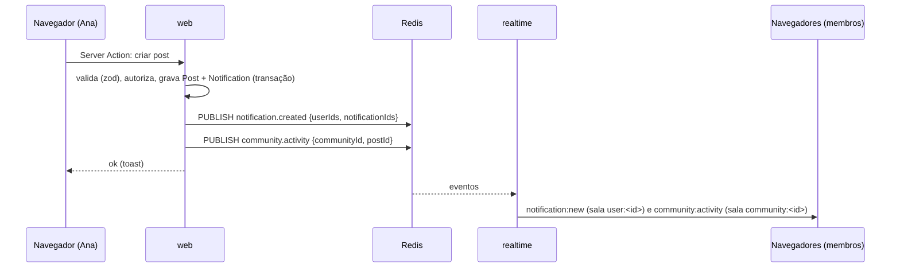
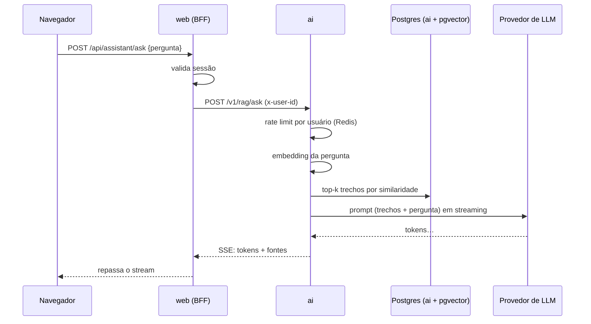

# Arquitetura

> Última atualização: 2026-10-17 — alinhada ao código: o domínio de trilhas e as notificações vivem no `web` (schema atual); os serviços satélites previstos são `realtime` e `ai`.
> Dono: Tech Lead. Mudanças aqui exigem PR revisada pelo Tech Lead e, se forem estruturais, uma ADR.

Este é o documento que **amarra todas as frentes**. Ele define o que é comum a todos: serviços, como conversam, onde ficam os dados e as convenções. O detalhe de cada parte fica no README da frente correspondente.

Cada item diz se **existe** no código ou se é **planejado**. Em caso de dúvida, o código vence ([hierarquia da verdade](README.md#hierarquia-da-verdade)).

## 1. Visão geral

### 1.1 Hoje



Dois containers de aplicação, definidos em [`docker/docker-compose.yml`](../docker/docker-compose.yml): `postgres` e `nextjs`. O `web` é um Next.js 16 em `apps/web` com as páginas `/` e `/login` (formulário ainda sem autenticação), o Route Handler `GET /api/health` e o Better Auth configurado em `src/lib/auth.ts` (ainda sem Route Handler montado).

### 1.2 Alvo



Resumo em uma frase: **o navegador fala só com o nginx; o `web` (Next.js) é a porta de entrada HTTP e o dono do domínio (usuários, trilhas, atividades, comunidades, eventos, notificações, emblemas); dois serviços satélites cuidam de tempo real e de IA; os serviços conversam por REST interno (síncrono) e por eventos no Redis (assíncrono).**

> 💡 **Conceito: microsserviços pragmáticos.** Microsserviços dividem o backend em processos independentes, cada um com uma responsabilidade, seu próprio banco e uma interface bem definida. O custo é complexidade: rede, consistência entre bancos, deploy. Por isso dividimos **só onde há motivo real**: o WebSocket precisa de um processo de longa duração (o Next.js não oferece isso nativamente) e a IA tem dependências, custos e limites próprios. O resto fica no `web`. Ver [ADR-0001](adr/0001-arquitetura-servicos.md).

## 2. Serviços

| Serviço | Responsabilidade única | Tecnologia | Banco | Frente | Porta | Estado |
|---|---|---|---|---|---|---|
| `nextjs` (`web`) | Interface + BFF + domínio: identidade, perfis, trilhas, atividades, comunidades, eventos, posts, notificações, emblemas, arquivos | Next.js 16 (App Router), Better Auth, Prisma 7 | principal | F2, F3, F4 | 3000 | Existe |
| `postgres` | Banco relacional | PostgreSQL 18 + PostGIS + pgvector (imagem Alpine própria) | — | F1 | 5432 | Existe (1 banco) |
| `prisma-studio` | Inspecionar o banco em dev (`make studio`) | Prisma Studio | principal | F1 | 5555 | Existe (profile `tools`) |
| `nginx` | Entrada única: TLS, roteamento, headers de segurança, bloqueio de rotas internas | nginx | — | F1 | 443 (host: `8443`) | Planejado |
| `realtime` | Comunicação em tempo real: conexões WebSocket, presença, chat, entrega de notificações | Fastify + Socket.IO, Prisma | `realtime` | F3 | 4001 | Planejado |
| `ai` | Assistente: geração de texto com LLM e RAG sobre trilhas | Fastify, SDK do provedor, Prisma + pgvector | `ai` | F5 | 4003 | Planejado |
| `redis` | Pub/sub de eventos e contadores de rate limit | Redis | — | F1 | 6379 | Planejado |
| observabilidade | Métricas, dashboards, alertas | Prometheus, Grafana, Alertmanager, exporters | — | F1 | — | Planejado |
| `backup` | Backups agendados e restauração | Container com `pg_dump` + cron | — | F1 | — | Planejado |

**Hoje** o `nextjs` publica a 3000 e o `prisma-studio` a 5555, em HTTP. **Alvo:** só o nginx publica porta no host; todos os outros ficam na rede interna do Docker. Isso é o que garante "HTTPS em todo lugar" do subject.

## 3. Comunicação

Tudo nesta seção, exceto o primeiro item de 3.1, é **planejado**.

### 3.1 Navegador → sistema

- **HTTP (páginas, formulários, APIs):** hoje navegador → `web` direto na porta 3000; alvo: navegador → nginx → `web`. O `web` usa Server Components para ler dados e Server Actions ou Route Handlers para escrever.
- **WebSocket:** navegador → nginx (`/socket.io/`) → `realtime`. O cookie de sessão vai junto no handshake (mesma origem).
- O navegador **nunca** chama `ai` diretamente. O `web` faz isso no servidor (padrão **BFF**, Backend for Frontend).

> 💡 **Conceito: BFF.** O "backend para o frontend" é a camada que o navegador enxerga. Ele autentica o usuário uma vez, chama os serviços internos e devolve exatamente o que a página precisa. Vantagens: um único ponto de autenticação, nenhum problema de CORS e serviços internos nunca expostos.

### 3.2 Serviço → serviço (REST interno, síncrono)

- URLs pela rede do Docker: `http://ai:4003`, `http://realtime:4001`, `http://nextjs:3000`.
- Toda chamada interna envia `x-internal-token` (segredo compartilhado, como Docker secret). O serviço recusa chamadas sem ele.
- O contexto do usuário vai em `x-user-id`, preenchido pelo `web` **depois** de validar a sessão. Serviços internos confiam nesse header apenas se o token interno for válido.
- `x-request-id` é propagado em toda a cadeia (o nginx gera) para correlacionar logs.
- Timeout padrão de 5 s; streams de IA, 60 s. Se o serviço chamado estiver fora, o `web` mostra um estado degradado e não quebra a página.
- No `web`, as rotas internas ficam em `/api/internal/*` e o **nginx bloqueia esse caminho para acesso externo**.

Contratos (endpoints, payloads): [contracts/README.md](contracts/README.md).

### 3.3 Eventos (Redis pub/sub, assíncrono)

- Um produtor publica um evento; quem tiver interesse assina. O produtor não sabe quem consome. É isso que deixa os serviços **desacoplados**.
- Envelope padrão (schema zod em `packages/contracts`, a criar):
  ```json
  { "id": "uuid", "type": "notification.created", "version": 1,
    "occurredAt": "2026-10-01T12:00:00Z", "producer": "web",
    "actorId": "user-id", "payload": { } }
  ```
- Canais por domínio: `events:notifications`, `events:community`, `events:social`, `events:trails`.
- **Entrega "no máximo uma vez":** se ninguém está assinando no momento (serviço reiniciando), o evento se perde. Aceitamos isso porque os dados importantes estão no banco e o cliente ressincroniza ao reconectar. Se isso virar problema, o caminho de evolução é Redis Streams ou BullMQ ([ADR-0005](adr/0005-comunicacao.md)).
- Publicar sem assinante é inofensivo. Por isso, **produtores podem publicar desde o primeiro dia**, mesmo antes de o consumidor existir.

> 💡 **Conceito: síncrono × assíncrono.** REST é síncrono: quem chama espera a resposta e depende do outro estar no ar. Eventos são assíncronos: quem publica segue a vida. Regra prática: use REST quando **precisa da resposta agora** (ex.: buscar trilhas para indexar no RAG) e evento quando está **avisando que algo aconteceu** (ex.: "notificação criada, entregue ao vivo").

### 3.4 Três fluxos de exemplo

**Mensagem de chat**



**Post em comunidade → notificação ao vivo**

As notificações são **gravadas pelo `web`** (tabela `Notification` do banco principal) e **entregues ao vivo pelo `realtime`**.



**Pergunta ao assistente (streaming)**



## 4. Autenticação e autorização

- **Better Auth** no `web` ([ADR-0004](adr/0004-autenticacao.md)). **Existe:** `src/lib/auth.ts` com adapter Prisma, e-mail e senha (hash com scrypt e salt, feito pela biblioteca), plugin `nextCookies()`; tabelas `User`, `Session`, `Account` (a senha fica em `Account.password`) e `Verification`; segredo `BETTER_AUTH_SECRET` lido do Docker secret pelo entrypoint. **Falta:** o Route Handler `app/api/auth/[...all]/route.ts`, o cliente de auth e as páginas funcionando.
- Sessão guardada no banco e enviada em cookie `HttpOnly`, `Secure` (com HTTPS), `SameSite=Lax`.
- Helpers do `web` (planejados, F2): `getSession()` (pode retornar nulo) e `requireUser()` (redireciona para `/login` ou retorna 401).
- **realtime (planejado):** no handshake, repassa o cookie para o endpoint de sessão do `web` e guarda o `userId` no socket. Socket sem sessão válida é recusado. O cliente **só tenta conectar depois do login**, para não sujar o console.
- **Serviços internos:** confiam no `x-user-id` vindo do `web` (com token interno válido). Cada serviço **autoriza** as próprias operações (ex.: o `realtime` verifica amizade antes de aceitar uma mensagem).
- **Autorização no `web`:** checar sempre no servidor (nunca só esconder botão). Papéis por comunidade, no enum `Role`: `ADMIN`, `MODERATOR`, `MEMBER` ([PRODUCT.md](PRODUCT.md#5-regras-de-produto)). Trilhas com `visibility = PRIVATE` só aparecem para o autor.

> 💡 **Conceito: autenticação × autorização.** Autenticar é provar **quem** você é (login). Autorizar é decidir **o que** você pode fazer (ex.: só o autor vê uma trilha privada). Bugs de autorização são os mais comuns em projetos web: toda query que retorna dados de outra pessoa precisa de um filtro de permissão.

## 5. Dados

### 5.1 Bancos

| Banco | Dono | Estado | Entidades |
|---|---|---|---|
| principal (`POSTGRES_DB`, padrão `trails`) | `web` | **Existe** | `User`, `Session`, `Account`, `Verification`, `Trail`, `Activity`, `Community`, `CommunityMember`, `Event`, `EventParticipant`, `Post`, `Notification`, `Badge`, `UserBadge`. Planejadas: `File`, `Friendship`, `Comment` |
| `realtime` | `realtime` | Planejado | `Conversation`, `Message`, `ConversationRead` |
| `ai` | `ai` | Planejado | `Document`, `Chunk` (embedding), `AiRequest` |

O diagrama e a descrição das tabelas que existem estão na seção [Database Schema do README](../README.md#database-schema), a partir de [`apps/web/prisma/schema.prisma`](../apps/web/prisma/schema.prisma) (fonte da verdade). Atualize o diagrama quando mudar uma **relação**, não a cada campo novo.

Regras:
1. **Nenhum serviço lê ou escreve no banco de outro.** Quando `realtime` e `ai` existirem, cada um terá um usuário de banco com permissão só no próprio banco (hoje há um usuário só, `POSTGRES_USER`).
2. **Referências entre serviços são por ID, sem chave estrangeira.** Exemplo: `Message.senderId` (banco `realtime`) aponta para um `User` do banco principal.
3. **Dentro do banco principal**, toda relação tem chave estrangeira. Apagar um usuário apaga em cascata o que é dele; apagar uma trilha deixa as atividades com `trailId` nulo.
4. IDs `cuid()` (as tabelas do Better Auth recebem o ID gerado pela biblioteca); timestamps em UTC (`createdAt`, `updatedAt`); datas exibidas em `America/Sao_Paulo`. Distâncias e desníveis em **metros**, durações em **segundos**.
5. **Integridade e concorrência:** use constraints `UNIQUE` (já existem: `CommunityMember(userId, communityId)`, `EventParticipant(eventId, userId)`, `UserBadge(userId, badgeId)`), transações para operações múltiplas e chaves de idempotência (ex.: `clientMessageId` no chat). É isso que atende ao requisito "sem race conditions" do subject.

> 💡 **Conceito: database-per-service.** Se dois serviços compartilham tabelas, uma mudança de schema quebra os dois: eles ficam acoplados. Com um banco por serviço, cada um evolui o próprio schema. O preço é que "joins" entre serviços viram chamadas de API. Usamos um único **servidor** Postgres para economizar memória; o isolamento é por **banco** e por **usuário**.

### 5.2 Geometria das trilhas

O percurso de uma trilha fica em `Trail.routeGeoJSON` (JSON com a geometria GeoJSON) e a área que ela ocupa em quatro colunas `Float`: `minLat`, `minLon`, `maxLat`, `maxLon` (bounding box). Assim:
- Filtrar pela área visível do mapa é uma comparação simples de intervalos (`maxLat >= s AND minLat <= n AND maxLon >= w AND minLon <= e`), feita pelo Prisma, sem SQL espacial.
- O PostGIS (extensão já criada no banco) fica disponível para o processamento da ingestão do OSM e para consultas que precisem dele, via `$queryRaw` com `ST_GeomFromGeoJSON`.

### 5.3 Prisma e migrations

- **Prisma 7:** configuração em `apps/web/prisma.config.ts` (schema, pasta de migrations e `DATABASE_URL`); o cliente usa o driver adapter `@prisma/adapter-pg` e é instanciado uma vez em `apps/web/src/lib/db.ts` (reaproveitado entre hot reloads em dev).
- **Um** arquivo, `apps/web/prisma/schema.prisma`, dividido por comentários (`better-auth core`, `trails`, `social`, `gamification`). Se os conflitos entre frentes aumentarem, dá para dividir em vários arquivos `.prisma` (suporte nativo do Prisma).
- **Criar migration:** `make migrate name=<descricao>` (roda `prisma migrate dev` no container). Commite o schema junto com `apps/web/prisma/migrations/`.
- **Uma migration por PR.** Se a `main` ganhou outra migration enquanto você trabalhava: faça rebase, apague a sua migration local e gere de novo.
- Migrations rodam automaticamente no start do container `nextjs` (`prisma migrate deploy`, em `docker/nextjs/tools/entrypoint.sh`). Ainda não há seed.
- **SQL puro:** só com `$queryRaw` com template tag (seguro contra SQL injection). **Nunca** `$queryRawUnsafe` com dado do usuário.

## 6. Estrutura do repositório

```
.
├── README.md  Makefile       # `make` sobe tudo (comando único exigido)
├── apps/
│   └── web/                  # Next.js: UI + BFF + domínio (npm, package-lock próprio)
│       ├── src/app/          # rotas do App Router (/, /login, /api/health)
│       ├── src/lib/          # auth.ts (Better Auth), db.ts (cliente Prisma)
│       ├── prisma/           # schema.prisma + migrations/
│       ├── public/
│       └── prisma.config.ts
├── docker/
│   ├── docker-compose.yml
│   ├── .env.example          # copiado para docker/.env pelo make
│   ├── secrets/              # db_password.txt, better_auth_secret.txt (gerados, fora do git)
│   ├── nextjs/               # Dockerfile + tools/entrypoint.sh
│   └── postgres/             # Dockerfile + tools/entrypoint.sh
├── data/postgres/            # dados do banco (bind mount, fora do git)
└── docs/
```

Previsto: `services/realtime` e `services/ai` (Fastify); `packages/contracts` (schemas zod compartilhados) e `packages/service-kit` (base Fastify); `docker/{nginx,prometheus,alertmanager,grafana,backup}`; `e2e/` (Playwright). Hoje cada app tem o próprio `package.json` e lockfile (npm); quando `packages/` existir, adotar npm workspaces ([ADR-0002](adr/0002-monorepo-typescript.md)).

## 7. Convenções transversais

| Tema | Convenção |
|---|---|
| Lint e formatação | Biome (`npm run lint`, `npm run format` em `apps/web`). |
| Imports no `web` | Alias `@/*` → `apps/web/src/*` (configurado no `tsconfig.json`). |
| Validação | zod (a instalar). O mesmo schema valida o formulário (react-hook-form) e o backend. Schemas compartilhados entre serviços ficam em `packages/contracts`. |
| Erros HTTP | Status correto + corpo `{ "error": { "code": "TRAIL_NOT_FOUND", "message": "…", "details": … } }`. Nada de stack trace na resposta. |
| Paginação | `?page=1&pageSize=20` → `{ items, page, pageSize, total }`. `pageSize` máximo de 50. |
| Logs | JSON (pino nos serviços Fastify), com `service`, `requestId`, `userId` quando houver. Sem senhas, tokens ou conteúdo de mensagens. |
| Métricas | Todo serviço expõe `/metrics` (formato Prometheus); o `web` expõe `/api/metrics`. Métricas RED (rate, errors, duration) por rota + métricas de negócio. |
| Saúde | Hoje: `GET /api/health` no `web` (consulta o banco). Alvo: `/health` (o processo está vivo?) e `/ready` (consegue atender? banco e Redis ok?) em todos os serviços. |
| Configuração | Dados não sensíveis em `docker/.env`; senhas e chaves como Docker secrets em `docker/secrets/*.txt`, lidos pelo entrypoint de cada container. Alvo: validar as variáveis com zod no boot. |
| Datas | ISO 8601 em UTC na API; formatação local só na UI. |
| Unidades | Metros e segundos no banco e na API; km, h e min só na UI. |
| Nomes | Código em inglês; textos de UI em pt-BR. Enums em maiúsculas (`EASY`, `PUBLIC`, `ADMIN`). Eventos `dominio.entidade.acao` (ex.: `community.post.created`). |
| Feature flags | Variáveis `FEATURE_*` para esconder funcionalidade incompleta da navegação. A `main` sempre pode ser demonstrada. |

## 8. Frontend

Hoje há só as páginas `/` e `/login`, sem estilo. O alvo:

- **App Router** do Next.js: Server Components por padrão; Client Components (`"use client"`) apenas onde há interatividade (mapa, chat, upload, formulários).
- **Estilo:** Tailwind CSS 4 (já nas dependências, falta configurar) + shadcn/ui (componentes acessíveis baseados em Radix). Ver [ADR-0008](adr/0008-frontend-mapas.md).
- **Formulários:** react-hook-form + zod.
- **Mapa:** Leaflet via react-leaflet, carregado só no cliente (`dynamic(..., { ssr: false })`), porque o Leaflet acessa `window`. Desenha o `routeGeoJSON` da trilha. Atribuição do OSM sempre visível.
- **Gráficos:** Recharts.
- **Estado:** comece sem biblioteca de estado global. Leitura com Server Components; escrita com Server Actions + `router.refresh()`; tempo real com estado local alimentado pelo socket. Adote TanStack Query apenas se a complexidade justificar (decisão da frente, registrada).
- **Busca:** filtros, ordenação e página ficam **na URL** (`searchParams`). A busca vira compartilhável e funciona com renderização no servidor.
- **Acessibilidade e responsividade** (obrigatórias): HTML semântico, `alt` em imagens, foco visível, navegação por teclado, lista de trilhas como alternativa ao mapa, layout mobile-first.

> 💡 **Conceito: Server × Client Components.** Server Components rodam no servidor, acessam dados diretamente e não mandam JavaScript para o navegador. Client Components rodam no navegador e podem usar estado, efeitos e eventos. Erros de **hydration** (texto diferente entre servidor e cliente, como datas ou `Math.random`) aparecem no console e reprovam o projeto.

## 9. Infraestrutura e execução

**Hoje:**
- **Comando único:** `make` → cria `docker/.env` (a partir do `.env.example`), os segredos em `docker/secrets/` (`openssl rand -hex 32`) e `data/postgres/`, se faltarem → `docker compose -f docker/docker-compose.yml up -d --build`. Comandos no [README](../README.md#instructions).
- **Imagens:** Alpine 3.24 montadas por nós, com `tini` como PID 1.
  - `postgres`: PostgreSQL 18 + PostGIS + pgvector. Na primeira subida (sem `PG_VERSION`), o entrypoint roda `initdb` com a senha do secret, libera conexões de rede com `scram-sha-256`, cria o banco `POSTGRES_DB` e as extensões `postgis` e `vector`. Healthcheck com `pg_isready`.
  - `nextjs`: Node + npm. O entrypoint lê os secrets, monta a `DATABASE_URL` e exporta o `BETTER_AUTH_SECRET`, roda `npm ci` se o `package-lock.json` for mais novo que o `node_modules`, `prisma generate`, `prisma migrate deploy` e por fim o comando (`npm run dev`).
- **Ordem de subida:** `nextjs` e `prisma-studio` esperam o `postgres` ficar `healthy`.
- **Desenvolvimento:** o código de `apps/web` é montado em `/app` no container (hot reload com `WATCHPACK_POLLING`); dependências novas com `make npm args="install <pacote>"`.
- **Volumes:** `postgres_data` (bind mount em `data/postgres/`).
- **Portas:** `nextjs` 3000 e `prisma-studio` 5555, em HTTP.

**Alvo:**
- **TLS:** o nginx gera um certificado autoassinado na primeira subida, se não houver um. O navegador mostra aviso, e isso é esperado. A porta 80 redireciona para a 443. Só o nginx publica portas.
- **Ordem de subida:** o Postgres sobe primeiro; depois cada serviço roda migrations e fica pronto; por último, o nginx.
- **Redes:** `public` (só nginx) e `internal` (todo o resto).
- **Volumes:** `postgres_data`, `uploads`, `backups`, `grafana-data`, `prometheus-data`.
- **Imagem de avaliação do `web`:** build de produção (`next build` + `next start`, ou `output: "standalone"`), em vez do `next dev`.
- **Recursos:** defina limites de memória e meça o consumo cedo (máquinas da 42 e WSL2). A observabilidade pode ficar em um profile do compose que é desligado no dia a dia.

## 10. Observabilidade, saúde e backups (planejado)

Detalhes em [frentes/plataforma/README.md](frentes/plataforma/README.md).

- **Prometheus** coleta `/metrics` de todos os serviços e dos exporters (node, cAdvisor, Postgres, Redis, nginx).
- **Grafana** com dashboards provisionados por arquivo (versionados no repo), servido em `/grafana/` via HTTPS, com login obrigatório.
- **Alertas:** regras no Prometheus (serviço fora, taxa de erro, latência, backup atrasado) → Alertmanager → canal `#alertas` no Discord.
- **Status page** em `/status`: consulta a saúde de cada serviço e o horário do último backup.
- **Backups** automáticos (`pg_dump` de cada banco + volume de uploads) com retenção, `make restore` e runbook de recuperação de desastre testado.

## 11. Segurança (checklist transversal)

- [ ] Só o nginx exposto; HTTP redireciona para HTTPS; HSTS e headers de segurança no nginx. *(Hoje: 3000 e 5555 expostas em HTTP.)*
- [ ] `/api/internal/*` e `/api/metrics` bloqueados no nginx; serviços internos exigem `x-internal-token`.
- [ ] Senhas com hash (Better Auth); rate limit no login.
- [ ] Validação zod no front **e** no back para toda entrada.
- [ ] Uploads: tipo verificado pelo conteúdo (magic bytes), tamanho limitado, nome aleatório no disco, metadados EXIF removidos das imagens, download só com permissão.
- [ ] Queries com dados do usuário apenas via Prisma ou `$queryRaw` com template tag.
- [ ] Conteúdo de usuário renderizado sem `dangerouslySetInnerHTML`; markdown da IA sanitizado.
- [x] Senhas e chaves em `docker/secrets/` (Docker secrets, fora do git); `docker/.env` sem senhas; `.env.example` sem valores reais.
- [ ] Prisma Studio fora da imagem de avaliação (profile `tools` não sobe no `make`).
- [ ] Grafana com senha forte e sem acesso anônimo; Prometheus e Alertmanager não expostos.

## 12. Decisões e questões em aberto

| ADR | Decisão | Status |
|---|---|---|
| [0001](adr/0001-arquitetura-servicos.md) | Next.js como web/BFF + 2 serviços satélites (`realtime`, `ai`) | Proposta |
| [0002](adr/0002-monorepo-typescript.md) | Monorepo com npm, TypeScript em tudo, Fastify nos serviços | Proposta |
| [0003](adr/0003-banco-de-dados.md) | Postgres: 1 servidor, 1 banco por serviço; Prisma; PostGIS e pgvector | Proposta (banco principal implementado) |
| [0004](adr/0004-autenticacao.md) | Better Auth com sessão em cookie | Proposta (configurado) |
| [0005](adr/0005-comunicacao.md) | REST interno + Redis pub/sub + Socket.IO | Proposta |
| [0006](adr/0006-dados-de-trilhas-osm.md) | Ingestão offline do OSM, seed versionado, elevação via Open-Meteo | Proposta |
| [0007](adr/0007-provedor-llm-embeddings.md) | Provedor de LLM e embeddings | **Pendente: decidir no kickoff** |
| [0008](adr/0008-frontend-mapas.md) | Tailwind + shadcn/ui, Leaflet, Recharts | Proposta |
| [0009](adr/0009-armazenamento-arquivos.md) | Arquivos em volume local com acesso autenticado | Proposta |

Questões em aberto (resolver com ADR ou nos planos das frentes):
- Trilhas importadas do OSM: qual usuário fica como `authorId` (ex.: uma conta do sistema)? (F4)
- Histórico do chat e lista de conversas: o `web` repassa para o `realtime` via REST (proposta) ou o cliente busca pelo socket? (F3)
- Status page: mostrar histórico de uptime via API do Prometheus? (F1, opcional)
