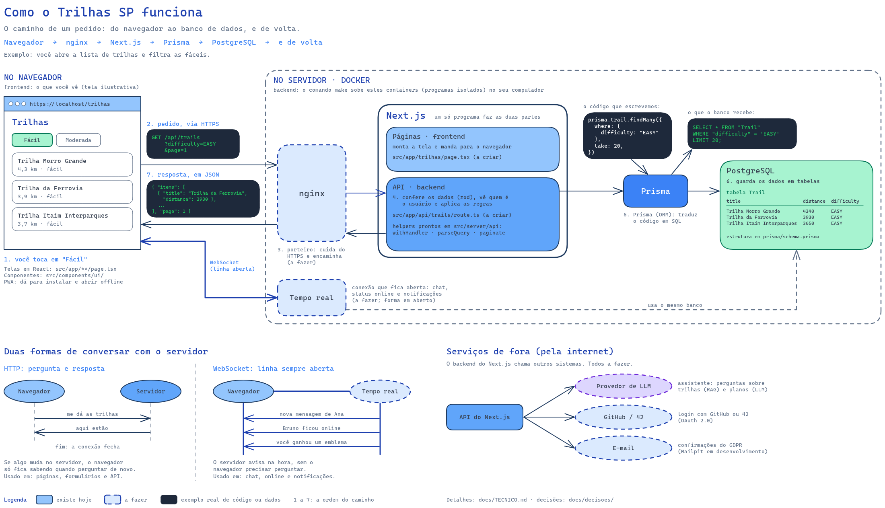

# Guia técnico

> Última atualização: 2026-10-22 — nginx com HTTPS na frente do app.
> O código vence este documento. Se encontrar divergência, corrija o doc no seu PR ou avise o dono da parte.

## Como as peças se encaixam

[](diagramas/arquitetura.png)

- **Existe hoje:** `nginx` (único com porta: HTTPS em `https://localhost:8443`; a 8080 redireciona), `nextjs` e `postgres`. O `prisma-studio` sobe só com `make studio`, em `127.0.0.1:5555`.
- **A fazer:** o processo de tempo real (Rafa, forma ainda em aberto), envio de e-mail (Di), provedor de LLM (Edu). Ver [decisoes/](decisoes/README.md).
- A IA roda dentro do Next.js (Route Handlers com streaming) e usa o pgvector do banco principal. Não há serviço separado.
- O navegador só fala com o nginx. Nenhuma outra porta fica exposta na versão de avaliação.

## Pastas

```
apps/web/                     Next.js (npm, package-lock próprio)
  src/app/                    rotas (páginas, Route Handlers em api/)
  src/components/ui/          design system (Juh)
  src/lib/                    auth.ts, auth-client.ts, db.ts
  src/server/api/             helpers de API: erros, validação, paginação (Gabs)
  src/server/<área>/          lógica de cada área (sugestão: auth, social, trails, ai, gamification)
  prisma/                     schema.prisma, migrations/, import-trails.mts, data/
  scripts/                    scripts de teste e utilitários
docker/                       compose, Dockerfiles, .env.example, secrets/, nginx/ (conf e certs/)
docs/                         esta documentação
```

Para evitar conflito, agrupe as rotas por área com *route groups* do Next.js: `app/(conta)`, `app/(social)`, `app/(trilhas)`, `app/(assistente)`.

## Rodar o projeto e mexer no banco

Comandos, pré-requisitos e o passo a passo para alterar o schema estão no [README](../README.md#instructions) (fonte única).

Regras do banco:
- **Uma migration por PR.** O Gabs revisa toda mudança no `schema.prisma`.
- Se a `main` ganhou uma migration enquanto você trabalhava: rebase, apague a **sua** pasta de migration (a que não foi mergeada), rode `make migrate name=...` de novo.
- Nunca edite uma migration já mergeada; crie outra.
- SQL puro só com `$queryRaw` com template tag. Nunca `$queryRawUnsafe` com dado do usuário.

## Convenções

| Tema | Regra |
|---|---|
| Idioma | Código, tabelas, rotas e nomes de arquivo em inglês; textos de tela, comentários e docs em pt-BR |
| Validação | zod no formulário **e** no servidor. No servidor: `parseBody`, `parseQuery`, `parseParams` de `@/server/api` |
| Escritas | Server Actions com `withAction`: devolvem `{ ok: true, data }` ou `{ ok: false, error }`. O erro volta como valor, sem 4xx no console. Exemplo: `src/server/trails/actions.ts` |
| Erros de API | `withHandler` + `ApiError`. Corpo: `{ "error": { "code": "TRAIL_NOT_FOUND", "message": "…", "details": … } }`. Nada de stack trace na resposta |
| Paginação | `?page=1&pageSize=20` → `{ items, page, pageSize, total }`; `pageSize` no máximo 50 (`paginate`, `paginated`) |
| Autorização | Sempre no servidor. Esconder um botão não é segurança |
| Unidades | Metros e segundos no banco e na API; km, h e min só na tela |
| Datas | UTC no banco e na API; formatar só na tela |
| Concorrência | `UNIQUE` no banco + transações; nunca "verifica e depois insere" |
| Segredos | Senhas e chaves em `docker/secrets/*.txt` (Docker secrets); o resto em `docker/.env`. Variável nova vai para o `docker/.env.example` |
| Imports | Alias `@/` aponta para `apps/web/src/` |
| Lint | Biome: `make npm args="run lint"` |
| Testes | `make test` (Vitest, num banco `_test` separado) e `bash tests/test-all.sh` (projeto inteiro, com o app no ar) |

## Interfaces entre pessoas

É aqui que as áreas se encontram. Antes de criar algo parecido, procure nesta tabela. Mudou uma assinatura? Atualize a linha e avise quem usa.

| Interface | Dono | Onde | Estado | Quem usa |
|---|---|---|---|---|
| `prisma` (cliente do banco) | Gabs | `src/lib/db.ts` | Existe | Todos |
| `schema.prisma` e migrations | Gabs revisa | `prisma/` | Existe | Todos |
| `withHandler`, `withAction`, `ApiError`, `parseBody/Query/Params`, `paginate` | Gabs | `src/server/api/` | Existe | Todos |
| `auth` (servidor) e `authClient` (navegador) | Di | `src/lib/auth.ts`, `src/lib/auth-client.ts` | Existe | Telas de conta |
| `getSession()` (pode ser nulo), `requireUser()` (401, para APIs e actions) e `requirePageUser()` (redireciona para `/login`, para páginas) | Di | `src/server/auth/session.ts` | Existe | Todos (hoje: trilhas, atividades) |
| Envio de e-mail | Di | a definir | A fazer | GDPR (e talvez 2FA) |
| Tokens de cor e tipografia + componentes | Juh | `src/components/ui/` | A fazer | Todas as telas |
| Layout (cabeçalho, rodapé, navegação) | Juh | `src/app/layout.tsx` | A fazer | Todas as telas |
| `notify(userId, …)` | Rafa | a definir | A fazer | Toda ação de criar, editar ou excluir |
| Envio de evento em tempo real para um usuário | Rafa | a definir | A fazer | Notificações, dashboard |
| Concessão de XP e emblemas | Edu | a definir | A fazer | Quem tem ação que dá XP (atividades) |
| Consultas de trilhas e atividades (`searchTrails`, `getTrail`, `listActivities`, `getActivityStats`) | Gabs | `src/server/trails/service.ts`, `src/server/activities/service.ts` | Existe | RAG, gamificação, dashboard, exportação |
| `exportUserData(userId)`: todos os dados pessoais em JSON, sem segredos | Gabs | `src/server/gdpr/export.ts` | Existe | GDPR (Di), exportação |

## Segurança

- [ ] Só o nginx expõe porta; HTTP redireciona para HTTPS. *(Implementado; falta conferir no navegador.)*
- [ ] Senhas com hash e salt (feito pelo Better Auth); rate limit no login (feito).
- [ ] Toda entrada validada no servidor.
- [ ] Upload de avatar: tipo verificado pelo conteúdo, tamanho limitado, nome aleatório, fora da pasta pública.
- [ ] Conteúdo de usuário e markdown da IA nunca vão para `dangerouslySetInnerHTML` sem sanitização.
- [x] Segredos fora do git (`docker/secrets/`, `docker/.env`).
- [ ] Prisma Studio não sobe no `make` (só no profile `tools`, em `127.0.0.1`). *(Implementado; falta conferir.)*

## Console limpo

Qualquer erro ou warning no console do Chrome reprova o projeto. Causas comuns neste stack:
- **Hydration mismatch:** data formatada diferente no servidor e no cliente, `Math.random()`, `Date.now()` no render.
- **Leaflet no servidor:** `window is not defined`. Carregue o mapa com `dynamic(..., { ssr: false })` e limpe o mapa ao desmontar.
- **Requisição "esperada" com erro:** buscar a sessão e receber 401, avatar padrão com 404, socket tentando conectar sem login.
- **React:** `key` faltando em listas, props inválidas no DOM.
- **PWA:** service worker falhando ao registrar (certificado), manifest ou ícone com 404, favicon faltando.
- **Tiles do mapa** bloqueados pelo provedor (403/429).

Teste sempre com o DevTools aberto, deslogado e logado.

## Git e PR

- **Branch:** `<tipo>/<descricao-curta>`, ex.: `feat/perfil-avatar`, `fix/chat-reconexao`.
- **Commits:** `<tipo>(<escopo>): <descrição em pt-BR>`. Tipos: `feat`, `fix`, `docs`, `refactor`, `test`, `chore`. Ex.: `feat(web): adiciona upload de avatar`.
  Ruins: `wip`, `ajustes`, `update`. O subject avalia o histórico: commits de todos, com mensagens claras.
- **PR** pequena, com o [template](../.github/pull_request_template.md) preenchido. Peça revisão de outra pessoa; obrigatória quando mexe no schema, no Docker/nginx ou numa [interface compartilhada](#interfaces-entre-pessoas).
- Antes de abrir: `git status` não lista nada de `docker/secrets/`, `docker/.env` ou `data/postgres/`.
- **Entrega na 42:** push do histórico completo (sem squash geral), para preservar os commits de todos.
