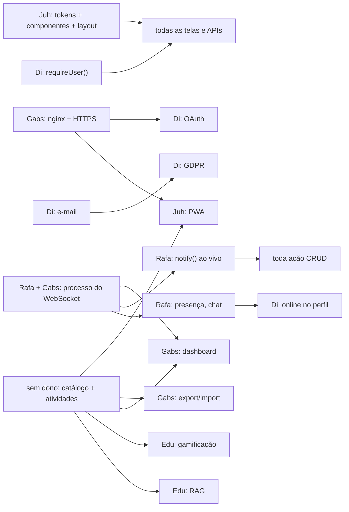

# Coordenação

> Para o Edu e o agente. O time não precisa ler. Retrato tirado em 2026-10-17: atualize quando mudar.
> Não repita aqui o que está nos docs do time. Escopo, módulos e decisões ficam em [PLANO](../PLANO.md), [MODULOS](../MODULOS.md) e [decisoes](../decisoes/README.md).

Nesta pasta: este arquivo (estado, dependências, o que cobrar), [prompts.md](prompts.md), [consultas-osm.md](consultas-osm.md) (POIs e parques para o RAG) e [planos/](planos/).

## Estado por pessoa

| Pessoa | Já fez (commits) | Próximo passo que destrava os outros | Atenção |
|---|---|---|---|
| **Juh** | — | Tokens, componentes básicos, layout com rodapé | Nenhum commit ainda; o subject exige commits de todos |
| **Gabs** | Correção do `package.json` + primeiro Makefile (`7242cdc`); schema do Better Auth + cliente Prisma (`7e2cb3f`); helpers de API + `/api/health` (`a13d497`); docs alinhados ao código (`85ff8ba`); importação do OSM (`1ccf712`) | nginx + HTTPS; testar o service worker com a Juh; decidir o WebSocket com o Rafa | Commits `wip` (`a13d497`, `1ccf712`, este com 3.886 arquivos); 16 MB de GPX sem uso; dados de trilhas sem filtro |
| **Di** | Correção da `DATABASE_URL` (`ce14249`); rotas do Better Auth, rate limit, cliente de auth, script de teste (`2cd0e23`…`e1ba98a`) | `getSession()` / `requireUser()` + telas de login e cadastro | Commits com dois nomes (`Diego Teruya`, `Teruya`), mesmo e-mail; inofensivo |
| **Rafa** | Docker inicial (`d0bdd82`); `/login` e auth WIP (`afef34b`); schema ampliado (`6dde86b`); reorganização em `apps/` + `docker/`, Docker secrets e Makefile (`3adf507`) | Decidir o WebSocket; `Friendship` no schema; `notify()` | Apagou `AGENTS.md`, `CLAUDE.md` e `CONTRIBUTING.md` em `3adf507` sem mencionar na mensagem; confirmar se foi intencional (o `CLAUDE.md` voltou na reestruturação). A infra que ele montou passa ao Gabs |
| **Edu** | Docs iniciais (`7128445`); reestruturação dos docs | Provedor de LLM ([llm.md](../decisoes/llm.md)); `mock` com streaming; esqueleto do planejador | RAG e gamificação dependem do catálogo, que está sem dono |

## Dependências

## A cobrar

- [ ] **Dono do catálogo de trilhas.** Não pode ficar para o fim: trava RAG, gamificação, dashboard, exportação e PWA offline.
- [ ] **Dados de trilhas** ([pendências](../dados-trilhas.md#pendências)): filtro (sobram ~88 trilhas), script que gerou o SQLite (não está no repo; perguntar ao Gabs quem rodou e onde está), fonte da elevação (o README credita Copernicus/Open-Meteo sem confirmação), destino dos GPX.
- [ ] Dono de Privacidade e Termos (pode ser no fim; é eliminatório).
- [ ] Papéis PO, PM e Tech Lead.
- [ ] Decisões pendentes em [decisoes/](../decisoes/README.md): WebSocket, certificado × PWA, e-mail, LLM.
- [ ] Primeiro commit da Juh.
- [ ] `.gitignore` ainda lista caminhos do plano antigo (`services/trails/…`, `services/ai/…`, `infra/nginx/certs/`): limpar quando o Gabs mexer no nginx.

## Rotina semanal (cerca de 15 min)

1. **Status:** rode o prompt "Resumo de status" ([prompts.md](prompts.md)) e mande o resultado para o time.
2. **Auditoria:** rode o prompt "Auditoria docs × código" e corrija o que for óbvio.
3. **Notificações:** confira se toda ação nova do código está na lista de MODULOS.
4. **Git:** `git shortlog -sne`: todo mundo commitando? Mensagens claras?
